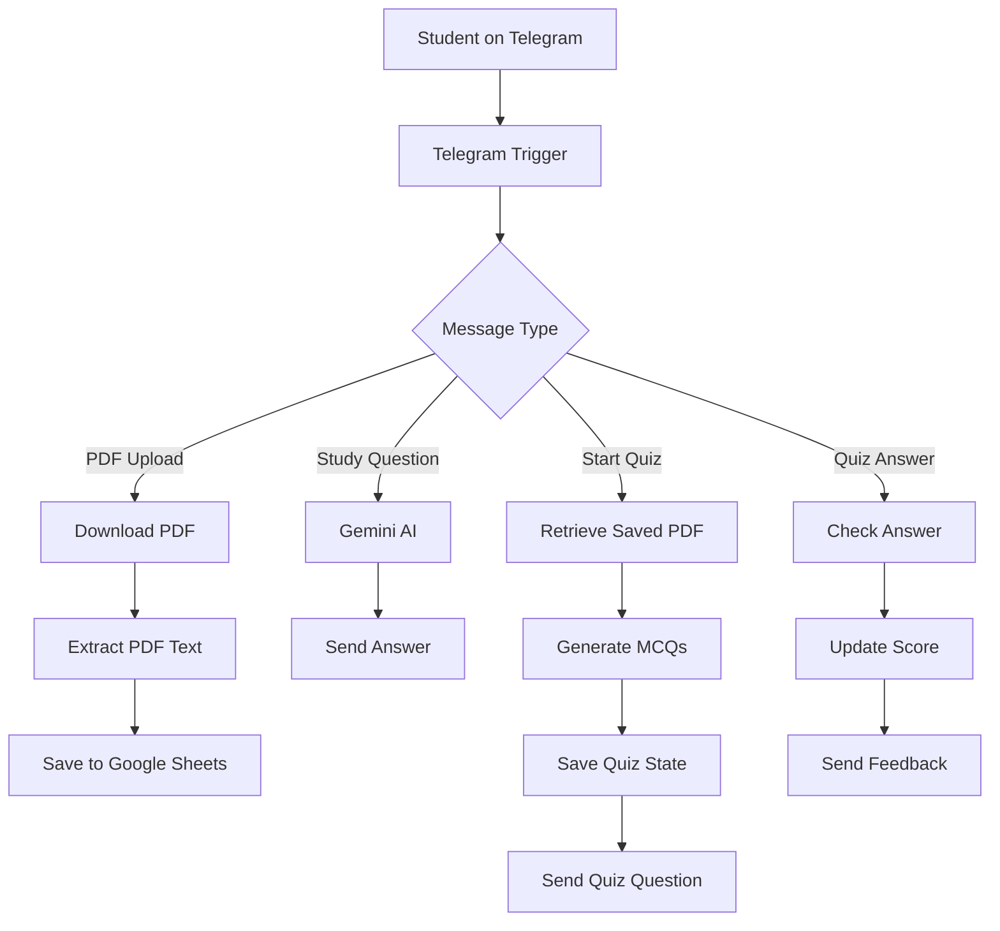

# 📚 StudyMate AI — PDF Study Assistant

An AI-powered Telegram bot that helps students study smarter by answering questions from PDFs, generating interactive quizzes, and tracking quiz scores. Built using **n8n, Google Sheets, Telegram Bot API, and Google Gemini AI**.

## 🚀 Features

- 📄 **PDF Study Assistant:** Upload study PDFs directly through Telegram.
- 🤖 **AI-Powered Answers:** Ask questions about your study material.
- 🧠 **Interactive Quiz Mode:** Generate multiple-choice questions based on saved PDFs.
- ✅ **Automatic Answer Checking:** Receive instant feedback on quiz answers.
- 📊 **Score Tracking:** Track quiz progress and scores.
- ☁️ **Google Sheets Integration:** Store uploaded documents, user details, and quiz states.
- 👋 **Smart Welcome System:** Welcome new users and returning users differently.
- ⚙️ **Workflow Automation:** Connect Telegram, Gemini AI, and Google Sheets through n8n.

## 🛠️ Tech Stack

| Technology | Purpose |
|---|---|
| n8n | Workflow automation |
| Telegram Bot API | Chatbot interface |
| Google Gemini AI | AI-generated answers and quizzes |
| Google Sheets | Document, user, and quiz data storage |
| JavaScript | Data processing and quiz logic |

## 🏗️ System Architecture

## 📸 Project Screenshots

### 🤖 Telegram Bot

See StudyMate AI in action on Telegram.

### ⚙️ n8n Workflow

The automation workflow connecting Telegram, Google Sheets, and Gemini AI.

## 🔄 How It Works

1. The student starts the bot on Telegram.
2. The student uploads a PDF containing study material.
3. n8n processes the PDF and extracts its text.
4. The extracted content is saved in Google Sheets.
5. The student starts a quiz using `/quiz`.
6. Gemini AI generates multiple-choice questions based on the selected PDF.
7. The student answers using A, B, C, or D.
8. The bot checks the answers, provides feedback, and updates the quiz score.

## 📊 Google Sheets Structure

The project uses Google Sheets to store the information required by the workflow.

### 1. StudyMate Documents

Stores uploaded PDF information:

- `chat_id`
- `document_name`
- `uploaded_at`
- `pdf_text`
- `text_length`

### 2. QuizState

Stores quiz session information:

- `chat_id`
- `questions_json`
- `current_question`
- `score`
- `total_questions`
- `status`
- `last_answer`

### 3. Users

Stores user information:

- `chat_id`
- `first_name`
- `welcome_sent`
- `last_seen`

## ⚙️ Setup and Installation

### Prerequisites

- A Telegram account
- An n8n instance
- A Telegram bot created using BotFather
- A Google account with Google Sheets access
- A Gemini API key

### Setup Steps

1. Create a Telegram bot using [BotFather](https://t.me/BotFather).
2. Set up an n8n instance.
3. Connect your Telegram bot credentials to n8n.
4. Create a Google spreadsheet named `StudyMate Documents`.
5. Create the required sheets and columns listed above.
6. Connect Google Sheets to n8n.
7. Configure Gemini AI credentials.
8. Import or build the workflow in n8n.
9. Configure the required node connections and expressions.
10. Activate the workflow and test the bot on Telegram.

## 🧪 Testing Checklist

- [ ] Start the bot using `/start`.
- [ ] Check the welcome message for new users.
- [ ] Check the welcome-back message for returning users.
- [ ] Upload a PDF and verify that its text is saved.
- [ ] Upload another PDF and check that the quiz uses the correct document.
- [ ] Start a quiz using `/quiz`.
- [ ] Submit answers using A, B, C, or D.
- [ ] Verify quiz feedback and score updates.
- [ ] Test quiz answers when no quiz is active.

## 🔐 Security

- Never upload API keys, Telegram bot tokens, or credentials to GitHub.
- Store secrets securely using n8n credentials or environment variables.
- Hide private Telegram chat IDs and personal information in screenshots.
- Review workflow exports before sharing them publicly.

## 🌟 Future Improvements

- 📌 Automatic PDF summarization
- 📝 Topic-wise quizzes
- 🎯 Personalized revision plans
- 📈 Student performance analytics
- 🔊 Voice-based study assistance
- 📚 Multi-subject support
- ⏰ Daily study reminders

## 👨‍💻 Author

**Prakarsh Shende**

Computer Science Engineering Student

GitHub: [@PrakarshShende](https://github.com/PrakarshShende)

---

⭐ If you find this project useful, consider giving the repository a star!
